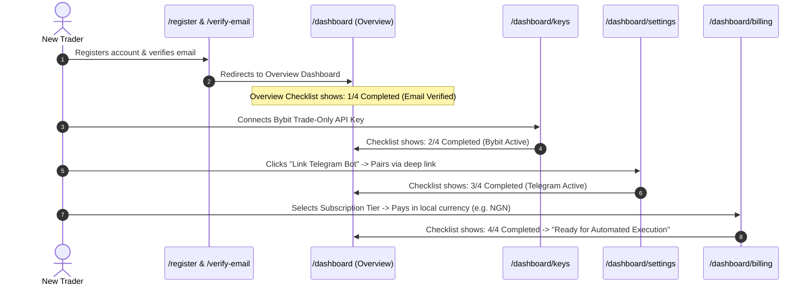

# Tadex Web Application: Application Sitemap & Navigation Architecture

**Status**: Architectural Baseline  
**Version**: 1.0.0  
**Scope**: Routing Hierarchy, Navigation Models, Access Controls & User Flows  

---

## 1. Application Routing Hierarchy & Sitemap

The application follows Next.js App Router conventions with distinct route groups and layout wrappers:

```mermaid
graph TD
    Root["/ (Root Layout: Theme, Fonts, Analytics)"]
    
    subgraph Public Marketing & Auth
        Root --> Marketing["/ (Marketing Landing Page)"]
        Root --> ForProviders["/for-providers (Signal Provider Acquisition)"]
        Root --> Legal["/privacy & /terms & /security"]
        Root --> AuthLogin["/login (Authentication)"]
        Root --> AuthRegister["/register (Onboarding)"]
        Root --> AuthForgot["/forgot-password & /reset-password"]
        Root --> AuthVerify["/verify-email"]
    end
    
    subgraph Authenticated App Shell ("/dashboard/*")
        Root --> DashLayout["/dashboard (Authenticated App Shell Layout)"]
        DashLayout --> DashOverview["/dashboard (1. Overview & Readiness)"]
        DashLayout --> DashTrading["/dashboard/trading (2. Trading Terminal)"]
        DashLayout --> DashAutomation["/dashboard/automation (3. Signal Engine & Logs - Proposed)"]
        DashLayout --> DashKeys["/dashboard/keys (4. Exchange Connections)"]
        DashLayout --> DashBilling["/dashboard/billing (5. Billing & Subscription Plans)"]
        DashBilling --> DashCheckout["/dashboard/billing/checkout/result (Payment Callback)"]
        DashLayout --> DashProviders["/dashboard/providers (Browse Provider Directory)"]
        DashProviders --> DashProviderDetail["/dashboard/providers/[id] (Provider Profile & Stats)"]
        DashLayout --> DashProviderPortal["/dashboard/provider (Signal Provider Workspace)"]
        DashLayout --> DashSettings["/dashboard/settings (6. Account & Security Settings)"]
    end
    
    subgraph Administrative Suite ("/admin/*")
        Root --> AdminLayout["/admin (Protected Admin Guard)"]
        AdminLayout --> AdminOverview["/admin (KPIs & Platform Overview)"]
        AdminLayout --> AdminUsers["/admin/users (User Directory & Ban Controls)"]
        AdminLayout --> AdminProviders["/admin/providers (Provider Management & Verification Queue)"]
        AdminLayout --> AdminExecution["/admin/execution (Execution Audit & Kill Switch)"]
        AdminLayout --> AdminSubscriptions["/admin/subscriptions (Subscription Ledger & Reconcile)"]
        AdminLayout --> AdminTransactions["/admin/transactions (Transaction Detail Views)"]
    end
```

---

## 2. Route Inventory & Access Matrix

| Route Path | View Name | Target Purpose | Access Guard | Primary Data Dependencies |
|---|---|---|---|---|
| `/dashboard` | **Overview & Readiness** | Operational snapshot, setup checklist, active position count, aggregate PnL, quick connectivity status. | `ProtectedRoute` | `GET /me`, `GET /keys`, `GET /billing/subscription`, `GET /trading/positions` |
| `/dashboard/trading` | **Trading Terminal** | Professional position monitor, active orders table, order history, execution sync engine. | `ProtectedRoute` | `GET /trading/positions`, `GET /trading/orders`, `GET /keys` |
| `/dashboard/automation` | **Automation Control** | Signal stream monitor, Telegram channel routing, execution safeguards, failure recovery logs. | `ProtectedRoute` | `GET /me`, `GET /billing/subscription`, Proposed `/automation/*` |
| `/dashboard/keys` | **Exchange Connections** | Bybit API key vault, testnet toggle, permission audit, connection health indicator. | `ProtectedRoute` | `GET /keys`, `POST /keys`, `DELETE /keys/{id}` |
| `/dashboard/providers` | **Provider Directory** | Marketplace of verified signal providers, win rates, subscriber counts, and trading styles. | `ProtectedRoute` | `GET /providers` |
| `/dashboard/providers/[id]` | **Provider Profile** | Detailed track record, published plans, win-rate breakdown, and subscription initiation. | `ProtectedRoute` | `GET /providers/{id}`, `GET /billing/plans` |
| `/dashboard/billing` | **Billing & Plans** | Active subscription entitlement, renewal countdown, multi-currency plan catalog (USD, NGN, KES, GHS). | `ProtectedRoute` | `GET /billing/subscription`, `GET /billing/plans` |
| `/dashboard/billing/checkout/result` | **Checkout Verification** | Transaction verification callback handler with auto-polling and retry mechanics. | `ProtectedRoute` | `GET /billing/checkout/verify?reference=...` |
| `/dashboard/provider` | **Provider Portal** | Dedicated workspace for signal providers: apply, verify, create custom subscription tiers. | `ProtectedRoute` | `GET /provider/me`, `POST /provider/apply`, `GET /provider/plans` |
| `/dashboard/settings` | **Account & Security** | Email verification, password rotation, Telegram account link/unlink, session revocation. | `ProtectedRoute` | `GET /me`, `POST /auth/change-password`, `POST /auth/telegram-link/request` |
| `/admin/*` | **Admin Suite** | System-wide operational dashboard, global kill-switch, fee management, verification queues. | `AdminRoute` (`role === 'admin'`) | `/admin/*` endpoints |

---

## 3. Navigation Architecture

### A. Desktop Navigation (Viewport $\ge$ 1024px) — Option A: Left Sidebar + Top Utility Bar
The desktop shell uses a structured **Left Sidebar (`w-64`)** paired with a **Top Utility Bar (`h-16`)** on `bg-surface-primary` (`#181818`), preserving the Figma designer's spatial composition while enforcing B4 dark surface tokens:

1. **Left Sidebar (`w-64`, `bg-surface-primary`, `border-r border-surface-elevated`)**:
   - **Brand Anchor (Top)**: Official Tadex upward signal mark ([`TadexLogo.tsx`](file:///c:/Users/user/Documents/tadex-landing2/src/components/ui/TadexLogo.tsx)) + `Tadex` wordmark.
   - **TRADING Section**:
     - `Dashboard` (`/dashboard`)
     - `Exchange Keys` (`/dashboard/keys`)
     - `Marketplace` (`/dashboard/providers`)
     - `Positions` (`/dashboard/trading`)
     - `Risk Control` (`/dashboard/automation` — centrally feature-flagged; hidden by default until backend contract is active)
     - `Billing & Plans` (`/dashboard/billing`)
   - **PROVIDER CENTER Section**:
     - `Provider Portal` (`/dashboard/provider`)
   - **SYSTEM ADMINISTRATION Section (Strictly Role-Gated)**:
     - Separated from regular trader navigation via role-based authorization (`user.role === 'admin'` and protected `/admin/*` route guards). Never exposed as operational links to regular retail users.
2. **Top Utility Bar (`h-16`, Sticky)**:
   - **Exchange Connection Beacon**: Pill showing `Bybit Mainnet` (Green dot) or `Disconnected` (Amber dot).
   - **Data Freshness Badge**: Discrete sync indicator with one-click manual refresh.
   - **Notifications & User Profile Menu**: Displays user email, verification badge, Telegram handle (`data-testid="header-telegram"`), link to `/dashboard/settings`, and `Log Out`.

### B. Mobile Navigation (Viewport $<$ 1024px)
Following Fitts's Law and mobile touch ergonomic best practices (as detailed in `better-layout` and `emil-design-eng`):

1. **Compact Top Bar (`h-14`)**:
   - Tadex Logo + active exchange status indicator + user avatar.
2. **Bottom Floating Action Dock (`h-16`)**:
   - Fixed to the bottom viewport (`bottom-0 inset-x-0`) with safe-area padding (`env(safe-area-inset-bottom)`).
   - Contains the 4 highest-frequency touch destinations:
     1. `Overview` (Icon + Label)
     2. `Trading` (Icon + Label)
     3. `Connections` (Icon + Label)
     4. `More / Menu` (Opens full-height modal drawer with Billing, Providers, Settings, and Provider Portal).

---

## 4. Primary User Journeys & State Transitions

### Journey 1: New Trader Onboarding (0 $\rightarrow$ Ready)


### Journey 2: Routine Trading & Execution Inspection
1. Trader logs in $\rightarrow$ Lands directly on `/dashboard` Overview.
2. Checks aggregate 24h PnL and active positions counter.
3. Navigates to `/dashboard/trading` to inspect entry prices, stop-loss trigger levels, and latest filled orders.
4. Coordinated sync cycle automatically refreshes data every 30 seconds with zero layout shift.

### Journey 3: Emergency Disarm / Safety Workflow
1. Trader detects anomalous market conditions or provider divergence.
2. Accesses top-bar or Trading Workspace disarm trigger.
3. Clicks **Emergency Halt** (requiring 2-step confirmation) or navigates to `/dashboard/keys` to instantly revoke the Bybit API key.
4. Execution stops immediately; visual banner confirms offline state.
