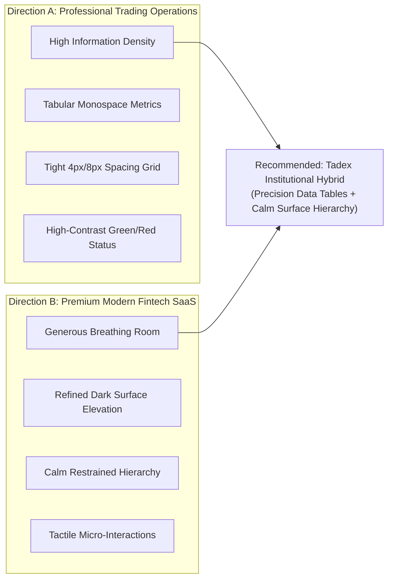
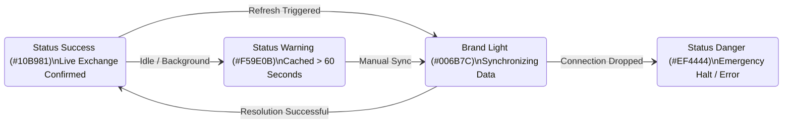

# Tadex Web Application: Visual Design Direction & Design System

**Status**: Design System Architecture & Directional Strategy  
**Version**: 1.0.0  
**Framework**: Next.js 16 + Tailwind CSS v3 + Geist / Geist Mono  
**Grounding**: `emil-design-eng`, `better-layout`, `web-design-engineer`, Perception Laws  

---

## 1. Visual Exploration: Direction A vs Direction B

To establish an authoritative visual identity that avoids generic AI dashboard cliches, we explored two distinct design archetypes:



### Direction A: Professional Trading Operations Platform
* **Inspiration**: Bloomberg Terminal, Bybit Pro Terminal, TradingView, Institutional Execution Desks.
* **Characteristics**:
  * Extreme information density with 0px–8px component gutters.
  * Monospace (`font-mono`) everywhere for exact column alignment.
  * Vibrant green (`#10B981`) and crimson (`#EF4444`) dominating the visual field.
  * Border-heavy containment with 1px gridlines dividing every table cell.
* **Strengths**: Immediate credibility for experienced derivatives traders; maximum data visible without scrolling.
* **Weaknesses**: Intimidating for retail traders and newcomers in African markets; causes visual fatigue during multi-hour sessions; flattens hierarchy into visual noise.

### Direction B: Premium Modern Fintech SaaS
* **Inspiration**: Linear, Stripe Dashboard, Mercury, Raycast.
* **Characteristics**:
  * Elegant dark surfaces with multi-layered depth (`#000000` $\rightarrow$ `#181818` $\rightarrow$ `#272727`).
  * Generous 16px–24px padding and relaxed typography.
  * Subtle borders (`border-border/40`) with muted text styles (`content-secondary`, `content-muted`).
  * Accent colors reserved strictly for primary interactive CTAs.
* **Strengths**: Extremely approachable, modern, and trustworthy; reduces anxiety around crypto execution; responsive layout scales effortlessly to mobile.
* **Weaknesses**: Can feel too spacious when reviewing 15+ open positions or scrolling deep execution histories; lower information density per screen inch.

---

## 2. Directional Evaluation Matrix

| Criterion | Direction A (Terminal) | Direction B (Fintech SaaS) | Recommended Tadex Hybrid |
|---|:---:|:---:|:---:|
| **Target Audience Fit** (Retail traders in Nigeria, Kenya, Ghana) | ⚠️ Moderate (Too complex) | ⚠️ Moderate (Lacks trading depth) | **✅ High (Approachable & Serious)** |
| **Information Density** | 9 / 10 | 6 / 10 | **8 / 10 (Adaptive Density)** |
| **Trading Workflow Clarity** | 8 / 10 | 7 / 10 | **9.5 / 10 (Clear Figure-Ground)** |
| **Brand Consistency** (With B4 Marketing Site) | ⚠️ Low (Disjointed) | 8 / 10 | **✅ 10 / 10 (Seamless Transition)** |
| **Mobile Responsiveness** | 4 / 10 (Heavy horizontal scroll) | 9 / 10 | **9 / 10 (Responsive Grids)** |
| **Operational Safety** (Emergency Halt / Key Status) | 7 / 10 | 8 / 10 | **10 / 10 (High-Contrast Affordance)** |

---

## 3. The Recommended Hybrid: "Tadex Institutional Precision"

We recommend the **Tadex Institutional Precision** hybrid. This combines:
1. **The calm, elevated surface architecture of modern fintech** for the shell, navigation, onboarding checklist, and billing.
2. **The crisp, tabular rigor and high-contrast execution feedback of professional trading desks** for the positions monitor, order history, and connection heartbeat.

### Key Tenets of the Hybrid Visual Language:
1. **Zero Generic AI Grids**: No generic 3-column card layouts filled with empty icons. Every card serves an explicit Gestalt group (`Law of Common Region`).
2. **Restrained Color Hierarchy**: Neutral charcoal surfaces (`#000000` to `#272727`) carry 90% of the screen. Accent colors (`#10B981` green, `#EF4444` red, `#004859` brand cyan) are strictly reserved for actionable or state-critical information.
3. **Tabular Numerics**: All balances, prices, PnL percentages, timestamps, and order quantities use `font-mono tabular-nums` to eliminate layout jitter during live refresh cycles.
4. **Physical Tactility**: Interactive buttons scale subtly on press (`active:scale-[0.98]`) with instantaneous state feedback. High-frequency actions (like toggling filters or tabs) feature **zero transition delay**.

---

## 4. Design System Tokens & Implementation Specification

### A. Surface & Elevation System (B4 Dark Palette)
All background surfaces are mapped to Tailwind tokens in [tailwind.config.js](file:///c:/Users/user/Documents/tadex-landing2/tailwind.config.js):

| Token Name | Hex Value | Semantic Role | Gestalt Layer |
|---|---|---|---|
| `bg-surface-canvas` | `#000000` | Application root viewport ground | Ground (Lowest) |
| `bg-surface-primary` | `#181818` | Top header, main layout containers, primary cards | Level 1 Surface |
| `bg-surface-subtle` | `#1F1F1F` | Nested panels, table headers, inactive tabs | Level 1.5 Inset |
| `bg-surface-secondary` | `#272727` | Form inputs, button secondary background, card hover | Level 2 Surface |
| `bg-surface-elevated` | `#313131` | Dropdowns, popovers, floating command bars | Level 3 Surface |
| Modal Scrim | `rgba(0,0,0,0.75)` | Background dimming layer for focused modals | Figure-Ground Isolator |

### B. Typographic System & Hierarchy
Using self-hosted **Geist** (prose & UI) and **Geist Mono** (numbers, tickers, and code):

| Style Name | Tailwind Utility Classes | Recommended Use Case |
|---|---|---|
| **Page Heading** | `.heading-4` (`text-2xl sm:text-3xl font-semibold tracking-tight`) | Screen titles (e.g. "Trading Workspace") |
| **Card Header** | `.title-2` (`text-lg font-medium text-content-primary`) | Module headers (e.g. "Active Positions") |
| **Table Header** | `.caption-4` (`text-xs font-medium text-content-muted uppercase tracking-wider`) | Column headers (e.g. "SYMBOL", "UNREALIZED PNL") |
| **Table Numeric** | `text-sm font-mono tabular-nums font-semibold` | Prices, quantities, percentages |
| **Body Text** | `.body-5` (`text-sm font-medium text-content-secondary`) | Descriptive subheads, helper text |
| **Micro Caption** | `.caption-5` (`text-xs font-normal text-content-muted`) | Timestamps, masked keys, fee disclaimers |

### C. Semantic State & Status Tokens



* **Positive / Profit**: `text-status-success` (`#10B981`), `bg-status-success/10`, `border-status-success/20`.
* **Negative / Loss / Destructive**: `text-status-danger` (`#EF4444`), `bg-status-danger/10`, `border-status-danger/20`.
* **Warning / Stale / Testnet**: `text-status-warning` (`#F59E0B`), `bg-status-warning/10`, `border-status-warning/20`.
* **Brand / Active Selection**: `bg-brand` (`#004859`), `hover:bg-brand-light` (`#006B7C`).

### D. Nested Radius System (Law of Concentricity)
To prevent awkward visual clashes between outer containers and inner elements:
* **Outer Modal / Section Container**: `rounded-2xl` (`16px`)
* **Inner Card / Data Table**: `rounded-xl` (`12px`)
* **Interactive Button / Input Field**: `rounded-lg` (`8px`)
* **Badges / Ticker Pills / Leverage Tags**: `rounded-md` (`6px`) or `rounded-full`

---

## 5. Interaction & Motion Rules (per `emil-design-eng`)

1. **High-Frequency Actions**:
   - Zero animation on tab changes, table filter toggles, search inputs, or navigation clicks. Latency here feels sluggish and frustrating.
2. **Action Feedback**:
   - Buttons must provide tactile click feedback via `:active` transform:
     ```css
     .tadex-button:active {
       transform: scale(0.98);
       transition: transform 50ms ease-out;
     }
     ```
3. **Modal & Sheet Entrances**:
   - Modals enter with a subtle scale and opacity shift:
     `scale(0.96) -> scale(1)` with `opacity: 0 -> 1` over `150ms` using `cubic-bezier(0.22, 1, 0.36, 1)`.
   - Never use `scale(0)` or bouncy spring curves on financial execution dialogs.
4. **Number Transitions**:
   - Numerical PnL changes do not spin or slide; they swap cleanly with subtle color flashes (e.g. green pulse for 300ms on positive fill) so numbers remain legible during high-volatility trading events.
