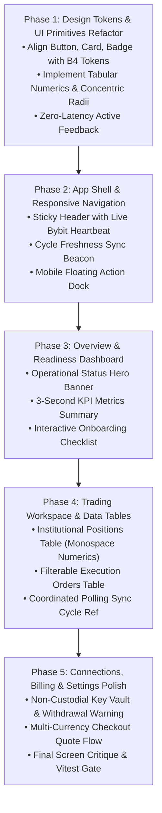

# Tadex Web Application: Implementation Roadmap & Execution Plan

**Status**: Engineering & Design Implementation Plan  
**Version**: 1.0.0  
**Methodology**: Phased Feature Branches, Contract Alignment, Mandatory Vitest Gate Criteria  
**Governing Standard**: `GEMINI.md`, `AGENTS.md`  

---

## 1. Phased Execution Roadmap

The implementation is broken down into five distinct, sequential phases. In accordance with `GEMINI.md`, each phase is executed on an isolated feature branch, requires full test suite verification prior to gate progression, and introduces zero regressions:

---

## 2. Phase-by-Phase Deliverables & Acceptance Criteria

### Phase 1: Design Tokens, Feature Flags & UI Primitives Harmonization
* **Goal**: Establish the reusable component foundation using `emil-design-eng`, `better-layout`, and B4 dark tokens, plus central feature flags for unbuilt backend capabilities.
* **Deliverables**:
  1. Create `src/lib/feature-flags.ts`: Centrally managed feature flags keeping unbuilt backend modules (`riskControl`, `signalBuilder`, `oauthLogin`, `otpLogin`, `manualPositionClose`, `emergencyHalt`, `revokeAllSessions`) disabled (`false`) by default so non-functional features are never exposed as operational capabilities.
  2. Refactor [button.tsx](file:///c:/Users/user/Documents/tadex-landing2/src/components/ui/button.tsx): Add tactile `:active` scale (`active:scale-[0.98]`), harmonize variants (`default`, `destructive`, `outline`, `secondary`, `ghost`, `link`, `brand`) with B4 semantic tokens (`bg-surface-*`, `text-content-*`, `border-surface-elevated`, `bg-brand-accent`).
  3. Refactor [card.tsx](file:///c:/Users/user/Documents/tadex-landing2/src/components/ui/card.tsx): Update background to `bg-surface-primary` (`#181818`), border to `border-surface-elevated` (`#313131`), and concentric `rounded-2xl` / inner padding hierarchy.
  4. Create `src/components/ui/StatusBadge.tsx`: Reusable status pill with semantic colors (`fresh`, `syncing`, `stale`, `danger`, `warning`, `neutral`) and indicator dot.
  5. Create `src/components/ui/NumericValue.tsx`: Standardized numeric renderer enforcing `font-mono tabular-nums` with currency formatting and sign coloring (`+$91.40` in `text-status-success`, `-$12.00` in `text-status-danger`).
* **Gate Acceptance Criteria**:
  * All existing test suites pass with zero regressions.
  * No arbitrary hex codes or unapproved tokens introduced.

---

### Phase 2: Application Shell & Responsive Navigation (Option A)
* **Goal**: Implement Option A navigation — Desktop Left Sidebar (`TRADING` & `PROVIDER CENTER`) + Sticky Top Utility Bar, and Mobile Bottom Navigation Dock, with strict role-based separation for Administration.
* **Deliverables**:
  1. Revamp [DashboardHeader.tsx](file:///c:/Users/user/Documents/tadex-landing2/src/components/dashboard/DashboardHeader.tsx) & [layout.tsx](file:///c:/Users/user/Documents/tadex-landing2/src/app/dashboard/layout.tsx): Implement the Desktop Left Sidebar + Top Utility Bar layout while preserving all existing test selectors and route contracts.
  2. Build `DashboardMobileNav.tsx`: Bottom floating action dock for mobile screens with safe-area padding (`env(safe-area-inset-bottom)`).
  3. Build `SyncFreshnessBeacon.tsx`: Coordinated sync trigger displaying seconds elapsed since last successful exchange fetch.
* **Gate Acceptance Criteria**:
  * Zero horizontal scroll or layout overflow at 320px, 375px, 768px, 1024px, and 1440px viewports.
  * Active link indicators match route pathname without flicker.

---

### Phase 3: Overview & Readiness Dashboard Revamp
* **Goal**: Transform `/dashboard/page.tsx` from a vertical stack of prototype cards into an institutional operational command center.
* **Deliverables**:
  1. Build `OperationalStatusBanner.tsx`: Top card displaying automation status (`ACTIVE`, `PAUSED`, `UNCONNECTED`), connected exchange, and active provider.
  2. Build `PortfolioKpiGrid.tsx`: 3-card metric strip showing active positions count, net unrealized PnL, and 24h execution volume.
  3. Revamp Onboarding Checklist: Interactive step tracker with direct deep links to `/dashboard/keys`, `/dashboard/settings`, and `/dashboard/billing`.
* **Gate Acceptance Criteria**:
  * Zero mock or fabricated financial figures rendered when no exchange key is connected.
  * Clean, inviting empty state when user has 0 active positions.

---

### Phase 4: Trading Workspace & Data Tables Refinement
* **Goal**: Deliver high-density, professional execution tables for `/dashboard/trading`.
* **Deliverables**:
  1. Revamp [PositionsTable.tsx](file:///c:/Users/user/Documents/tadex-landing2/src/components/dashboard/PositionsTable.tsx): Implement `font-mono tabular-nums` alignment, long/short semantic badges, liquidation and mark price display, and responsive card-collapse for mobile.
  2. Revamp [OrdersTable.tsx](file:///c:/Users/user/Documents/tadex-landing2/src/components/dashboard/OrdersTable.tsx): Add status filter tabs (`All`, `Filled`, `Cancelled`, `Rejected`), relative timestamps with exact hover tooltips.
  3. Implement `syncCycleRef` coordinated polling: Ensures `TradingPage.tsx` updates `lastSyncedAt` only when both position and order feeds successfully resolve.
* **Gate Acceptance Criteria**:
  * Table columns align cleanly with zero header/cell drift.
  * Passing `TradingPage.test.tsx`, `PositionsTable.test.tsx`, and `OrdersTable.test.tsx`.

---

### Phase 5: Connections, Billing, Settings & Final Audit
* **Goal**: Polish the supporting operational areas and perform design critique validation.
* **Deliverables**:
  1. Revamp [ApiKeyManager.tsx](file:///c:/Users/user/Documents/tadex-landing2/src/components/dashboard/ApiKeyManager.tsx): High-trust non-custodial assurance banner, Bybit testnet toggle, withdrawal permission warning modal.
  2. Polish [SubscriptionCard.tsx](file:///c:/Users/user/Documents/tadex-landing2/src/components/dashboard/SubscriptionCard.tsx) & [PricingGrid.tsx](file:///c:/Users/user/Documents/tadex-landing2/src/components/dashboard/PricingGrid.tsx): Multi-currency selector (USD/NGN/KES/GHS), itemized quote modal, and payment status recovery.
  3. Run Screen Critique Suite:
     - `critique-visual-hierarchy`: Verify eye lands on execution health first.
     - `critique-color`: Verify WCAG AA contrast on all dark surfaces.
     - `critique-affordance`: Verify Emergency Halt is visually unmistakable from standard buttons.
  4. Run `interface-review` against Git baseline.
* **Gate Acceptance Criteria**:
  * 100% test pass rate across the Vitest suite.
  * Full CHANGELOG documentation updated.

---

## 3. Testing & Visual Acceptance Criteria

| Check | Tool / Method | Acceptance Threshold |
|---|---|---|
| **Unit & Integration Tests** | `npm.cmd test -- --run` | 100% passing (min 43 test suites / 181+ tests). |
| **Type Integrity** | Next.js build / TypeScript | Zero type errors (`tsc --noEmit`). |
| **Accessibility (a11y)** | WCAG 2.2 AA Audit | Contrast ratio $\ge$ 4.5:1 for normal text, 3:1 for large text / indicators. |
| **Mobile Responsiveness** | Viewport Stress Testing | No horizontal scrolling at 320px; touch targets $\ge$ 44px $\times$ 44px. |
| **Gestalt Containment** | `law-of-common-region` | Max 2 levels of nested card surfaces; clear boundary between modules. |
| **Data Realism** | Contract Verification | Zero placeholder/mock data rendered in production screens. |
