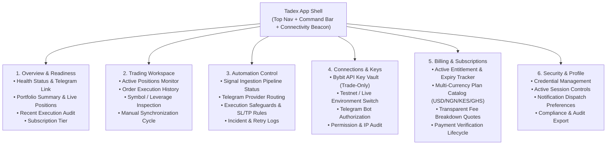
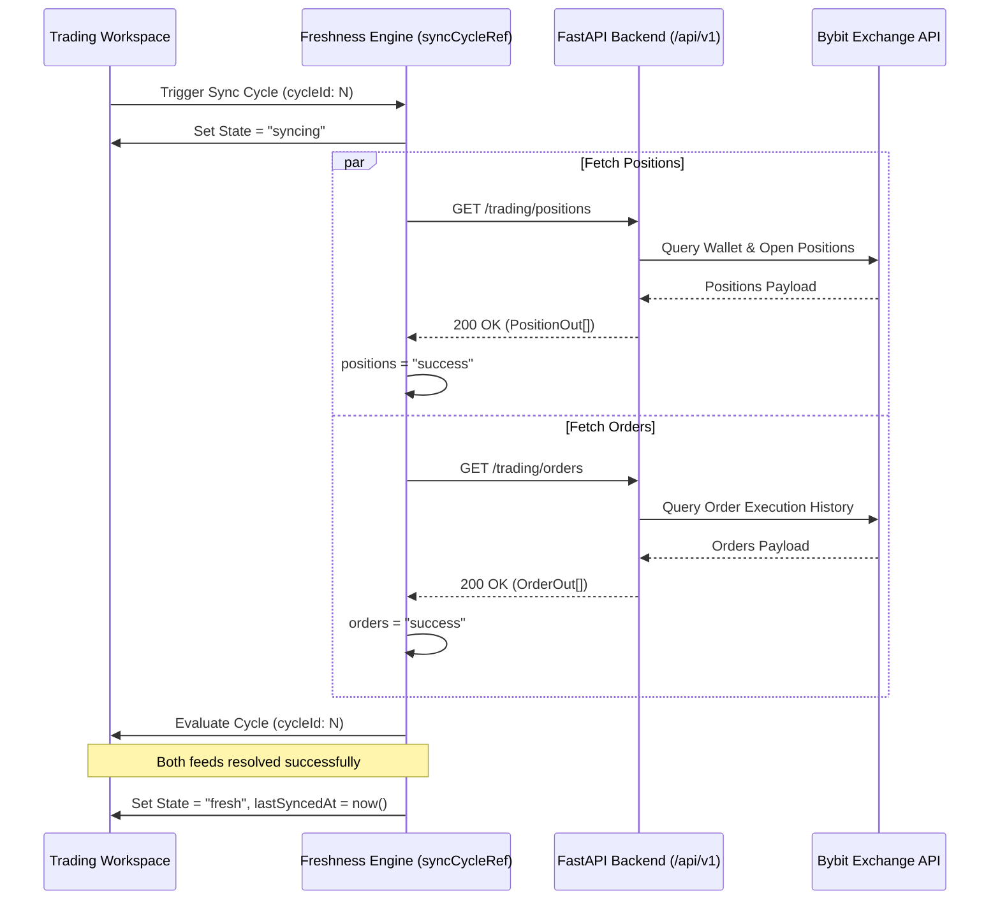

# Tadex Web Application: Product Architecture Specification

**Status**: Architectural Baseline & Design Specification  
**Version**: 1.0.0 (Production Target)  
**Author**: Antigravity Technical Lead & Design Engineer  
**Scope**: Authenticated Web Application & Trading Automation Interface  

---

## 1. Executive Summary & Core Mission

Tadex is a **non-custodial crypto signal execution automation platform** built for retail traders and signal provider communities (focusing on Nigeria, Kenya, Ghana, and broader emerging markets). 

The platform bridges trading communities on Telegram with centralized exchange accounts (currently **Bybit**, with **Binance** planned). Users connect trade-only API keys, subscribe to verified signal providers, and have trade signals automatically executed in their exchange accounts with zero manual order-entry latency.

### Non-Negotiable Operational Principles
1. **Strictly Non-Custodial**: Tadex never holds user funds, never possesses withdrawal permissions, and never routes capital through internal custodial wallets. If an API key with withdrawal permissions is supplied, the backend immediately rejects it.
2. **Execution Integrity**: Trading automation involves real monetary risk. Bounded idempotency, explicit state tracking, transparent error envelopes, and fail-safe execution switches are paramount.
3. **Data Transparency**: No fabricated metrics, mock balances, or simulated win rates. Exchange-confirmed data must be visually distinct from estimates or cached snapshots.

---

## 2. Technical Infrastructure Audit: Existing vs Proposed vs Missing

To ensure design decisions are grounded in reality rather than assumption, the following matrix reconciles the verified backend and frontend capabilities against proposed dashboard requirements:

| Application Domain | Verified Backend Endpoint | Verified Request / Response Payload | Frontend Integration State | Architecture Classification |
|---|---|---|---|---|
| **Auth & Session** | `POST /auth/login` `POST /auth/refresh` `POST /auth/logout` `GET /me` | `TokenResponse` (memory access token + httpOnly refresh cookie). `UserOut` (`id`, `email`, `status`, `email_verified`, `telegram_linked`, `telegram_username`). | Fully integrated via `apiClient` fetch wrapper & Zustand `useAuthStore`. | **Verified Existing** |
| **Password & Security** | `POST /auth/change-password` | `{ current_password, new_password }` | Integrated in `AccountSettings.tsx`. | **Verified Existing** |
| **Session Revocation** | `POST /auth/logout-all` (Planned) | Expected: Revokes all refresh tokens. | Skeleton UI present; requires backend route confirmation. | **Missing Backend Contract** |
| **Telegram Integration** | `POST /auth/telegram-link/request` `POST /auth/telegram/unlink` | Request returns `{ deep_link }`. Unlink requires `{ current_password }`. | Integrated in `AccountSettings.tsx`. | **Verified Existing** |
| **Exchange Keys** | `GET /keys` `POST /keys` `DELETE /keys/{id}` | Connect payload: `{ exchange: "bybit", api_key, api_secret, is_testnet }`. Response: `{ id, exchange, api_key_masked, is_testnet, status, created_at, last_used_at }`. | Integrated in `ApiKeyManager.tsx`. Enforces withdrawal rejection handling. | **Verified Existing** |
| **Active Positions** | `GET /trading/positions` | Array of `PositionOut`: `{ id, symbol, side, size, entry_price, unrealized_pnl, leverage, stop_loss, take_profit }`. | Integrated in `PositionsTable.tsx`. | **Verified Existing** |
| **Execution Orders** | `GET /trading/orders?status=...` | Array of `OrderOut`: `{ id, symbol, side, status, size, price, order_type, stop_loss, take_profit, timestamp }`. | Integrated in `OrdersTable.tsx`. Supports status filtering. | **Verified Existing** |
| **Manual Position Close** | `POST /trading/positions/{id}/close` | Proposed: Market close order dispatch to exchange. | Not implemented in frontend or documented in OpenAPI. | **Missing Backend Contract** |
| **Emergency Halt / Kill Switch (User)** | `POST /trading/emergency-halt` | Proposed: User-level halt that pauses signal execution and cancels open trigger orders. | Admin kill-switch exists (`/admin/kill-switch`); User-level emergency pause needs contract. | **Proposed / Missing Contract** |
| **Subscriptions & Billing** | `GET /billing/subscription` `GET /billing/plans` `GET /billing/quote` `POST /billing/checkout` `GET /billing/checkout/verify` | Multi-currency quotes (USD, NGN, KES, GHS). Paystack / gateway redirect & polling verification. | Integrated in `SubscriptionCard.tsx`, `PricingGrid.tsx`, `CheckoutQuoteModal.tsx`, `CheckoutResult.tsx`. | **Verified Existing** |
| **Signal Providers** | `GET /providers` `GET /providers/{id}` `GET /provider/me` `POST /provider/apply` `POST /provider/plans` | Provider directory, application review, custom tier creation, and verification identity. | Integrated in Provider directory and Provider Portal. | **Verified Existing** |
| **Realtime Streaming (WebSockets)** | None | Currently REST-only polling architecture. | No WebSocket server exists in the backend API contract. | **Architecture Constraint: REST Polling Only** |

---

## 3. Core Architectural Pillars

The authenticated Tadex web application is structured around six core operational areas:

### Pillar 1: Overview Dashboard
- **Objective**: Deliver an instant, glanceable operational snapshot within 3 seconds of login.
- **Key Capabilities**:
  1. *Connectivity & Readiness Checklist*: Step-by-step progress tracking for email verification, exchange key connection, Telegram bot linking, and active subscription.
  2. *Live Execution Status*: Unambiguous badge indicating whether automated execution is `ACTIVE`, `PAUSED`, `UNCONFIGURED`, or `ERROR`.
  3. *Portfolio Health & Positions Summary*: Active open positions count, aggregate unrealized PnL, and latest order execution timestamp.
  4. *Subscription Entitlement*: Current plan tier, renewal countdown, and quick-action renewal triggers.

### Pillar 2: Trading Workspace
- **Objective**: Provide high-density, professional execution visibility mirroring institutional terminals.
- **Key Capabilities**:
  1. *Positions Monitor*: Symbol, Side (Long/Short badge with distinct semantic color), Size, Entry Price, Mark Price, Unrealized PnL (with percentage and dollar amount), Leverage pill, and Stop Loss / Take Profit parameters.
  2. *Orders & Execution Ledger*: Historical execution trail with filters (`all`, `filled`, `cancelled`, `rejected`), fill price, timestamp, and order type (`market`, `limit`).
  3. *Exchange Data Freshness Engine*: Coordinated sync cycle tracking that updates timestamps only when both position and order feeds successfully resolve.

### Pillar 3: Automation Control (Signal Engine)
- **Objective**: Provide absolute transparency into incoming signals and how they are parsed, sized, and dispatched to the user's exchange account.
- **Key Capabilities**:
  1. *Pipeline Status*: Ingestion health from linked Telegram signal channels.
  2. *Risk & Sizing Parameters*: Display of user-configured risk per trade (e.g., fixed margin or percentage equity), max leverage caps, and default SL/TP rules (where supported by backend).
  3. *Execution Log*: Chronological feed of signal parsing events (Received -> Validated -> Sized -> Dispatched -> Confirmed by Bybit).

### Pillar 4: Connections & API Key Vault
- **Objective**: Establish bulletproof user trust through transparent security protocols and non-custodial guardrails.
- **Key Capabilities**:
  1. *Bybit Integration*: Seamless setup modal with step-by-step instructions for creating a "Trade-Only" sub-account key on Bybit.
  2. *Withdrawal Permission Detection*: Immediate client-side and backend validation blocking keys that have withdrawal permissions enabled.
  3. *Telegram Deep-Link Flow*: One-click OAuth / bot deep-link generation (`/auth/telegram-link/request`) with instant pairing detection.
  4. *Testnet vs Mainnet Sandboxing*: Visual tag and strict separation between Bybit Testnet (paper execution) and Live Trading environments.

### Pillar 5: Billing & Multi-Currency Subscriptions
- **Objective**: Eliminate payment friction for African and international traders via transparent, multi-currency local pricing.
- **Key Capabilities**:
  1. *Tier Catalog*: Starter, Pro, and Provider plans with dynamic pricing in USD, NGN (Nigerian Naira), KES (Kenyan Shilling), and GHS (Ghanaian Cedi).
  2. *Itemized Quote Generator*: Transparent modal showing provider subscription fee + Tadex platform fee + gateway charges prior to redirecting to Paystack or alternative gateways.
  3. *Payment Resumption & Verification*: State persistence in `sessionStorage` with polling verification (`/billing/checkout/verify`) and automated retry on network interruptions.

### Pillar 6: Security & Account Settings
- **Objective**: Provide granular user control over credentials, sessions, and compliance records.
- **Key Capabilities**:
  1. *Profile & Verification*: Email verification status with resend verification link triggers.
  2. *Password Rotation*: Zod-validated password change form enforcing security standards.
  3. *Telegram Account Decoupling*: Secure unlink workflow requiring password verification before active automation is severed.

---

## 4. Data Delivery Architecture & Freshness States

Because the current Tadex backend does not feature a persistent WebSocket gateway for real-time telemetry, the frontend uses an **authoritative polling cycle pattern**:

### The Six Data Freshness States
1. **Exchange-Confirmed (Fresh)**: Data received within the last 30 seconds directly verified from exchange endpoints. Green indicator dot (`status-success`).
2. **Synchronizing**: Active fetch in progress. Neutral pulsing spinner (`brand-accent`).
3. **Stale (> 60s)**: Background poll delayed or user idle. Amber clock badge (`status-warning`) with exact "Synced 2m ago" text.
4. **Degraded / Rate-Limited**: Exchange API returned 429 or transient error. Clear warning banner preserving last-known data with an explicit "Cached" watermark.
5. **Disconnected / Unconfigured**: No API key attached. Clean empty state with zero fabricated balances and direct CTA to connect Bybit.
6. **Error / Credential Invalid**: Exchange rejected key (e.g., expired or IP blocked). Red alert badge (`status-danger`) requiring re-authentication.

---

## 5. Security & Risk Mitigation Protocols

1. **Trade-Only Permission Enforcement**:
   - The UI never renders a field for withdrawal passwords or Google Authenticator 2FA keys intended for fund transfers.
   - During key submission, explicit warnings explain that Bybit API keys must only have "Contract Trading" or "Spot Trading" permissions checked.
2. **Key Storage & In-Flight Privacy**:
   - Secrets are submitted directly over TLS.
   - Once submitted, the backend never returns raw API secrets. Keys are always returned in masked format (e.g., `byb***94a`).
3. **Emergency Disarm**:
   - If a trader needs to halt automation, disconnecting the key or clicking Emergency Halt immediately invalidates the execution token and ceases automated order submission.
